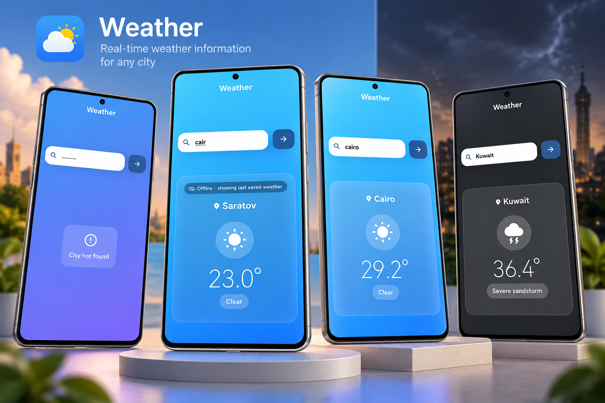

<div align="center">

# 🌤️ Weather Application

### Modern Weather Forecast App Built with Flutter

A clean and responsive weather application
developed using **Flutter and Dart**.

Designed to provide an intuitive experience
for viewing weather conditions and forecasts
through a modern mobile interface.


</div>

---

## 📸 Project Preview

<div align="center">

<a href="98688347-34ef-4897-aec0-c8444967aca1.png">
  
</a>

</div>

---

## 📖 About the Project

**Weather Application** is a Flutter-based
application focused on presenting weather
information through a clean, intuitive,
and user-friendly interface.

The project demonstrates Flutter UI
development, responsive layouts,
and weather application design.

---

## ✨ Key Features

- 🌡️ Weather information display.
- 🌤️ Current weather conditions.
- 📅 Weather forecast interface.
- 📱 Modern and responsive UI.
- 🎨 Clean weather-themed design.
- 🔄 Dynamic weather data presentation.
- 🚀 Cross-platform Flutter foundation.

---

## 🛠️ Tech Stack

| Technology | Purpose |
|------------|---------|
| Flutter | User interface |
| Dart | Application development |
| Material Design | UI components |
| Git | Version control |
| GitHub | Source code hosting |

---

## 🏗️ Application Architecture

The application follows a Flutter-based
structure for displaying weather data.

```text
       Flutter Application
               |
               v
         Weather UI
               |
               v
       Application Logic
               |
               v
         Weather Data
               |
               v
       Weather Information
```

---

## 📱 User Experience

The application focuses on:

- Clear presentation of weather information.
- Easy-to-read temperature values.
- Organized weather details.
- Simple navigation.
- Responsive interface design.

---

## 🚀 Getting Started

### Prerequisites

Make sure you have installed:

- Flutter SDK
- Dart SDK
- Android Studio or VS Code
- Git

### 1. Clone the Repository

```bash
git clone https://github.com/AhmedJaberAhmed/The-weather-Application.git
```

### 2. Navigate to the Project

```bash
cd The-weather-Application
```

### 3. Install Dependencies

```bash
flutter pub get
```

### 4. Run the Application

```bash
flutter run
```

If the project uses a weather API,
configure its required API credentials
according to the application source code.

---

## 💡 Development Highlights

This project demonstrates experience in:

- Flutter UI development.
- Building responsive interfaces.
- Presenting weather information.
- Organizing application components.
- Developing cross-platform applications.

---

## 🎯 Project Goals

- Build an intuitive weather application.
- Present weather data clearly.
- Create an attractive Flutter interface.
- Practice cross-platform development.
- Deliver a smooth user experience.

---

## 👨‍💻 Developer

**Ahmed Jaber Ahmed**

Flutter Developer | Mobile App Developer

B.Sc. Computer Science & Artificial Intelligence

📍 Cairo, Egypt

- [GitHub](https://github.com/AhmedJaberAhmed)
- [Portfolio](https://ahmedjaberahmed.github.io/Jaber-website/)
- [LinkedIn](https://www.linkedin.com/in/ahmedjaberahmed/)

---

<div align="center">

### ⭐ Support the Project

If you find this project interesting,
consider giving it a star!

**Made with Flutter 💙**

</div>
